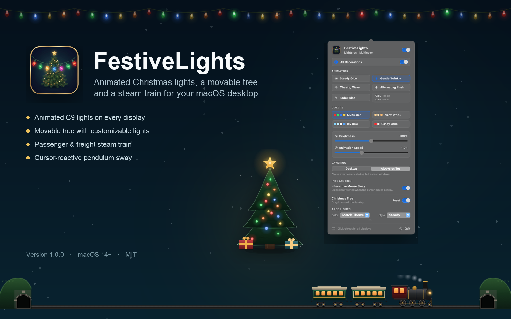
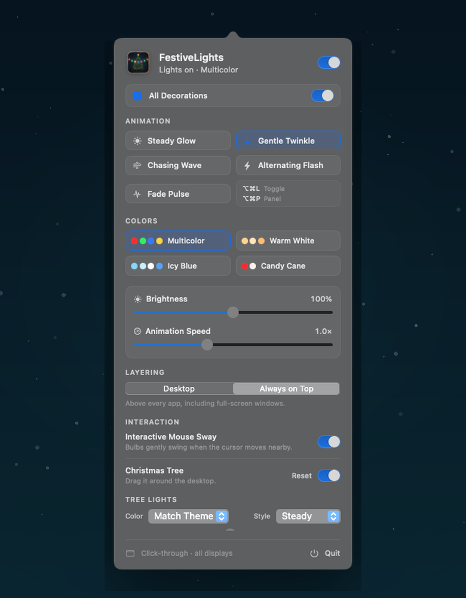
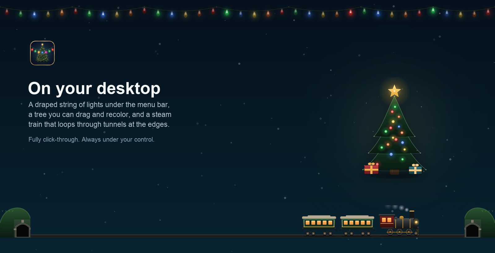

# FestiveLights



Animated C9 Christmas lights under the menu bar, a movable Christmas tree, and
a steam train that loops through tunnels above the Dock. A native macOS menu
bar app built with SwiftUI and AppKit.

[**Download the latest DMG**](https://github.com/frankt2012/FestiveLights/releases/latest) · macOS 14+ · Free & open source · MIT

## Install

1. Download the latest `FestiveLights-1.0.0.dmg`.
2. Open the DMG and drag **FestiveLights** into **Applications**.
3. Launch it from Applications. It is a menu bar app: look for the lightbulb
   icon in the menu bar.

The build is ad-hoc signed, not notarized. If macOS blocks the first launch,
right-click **FestiveLights** in Applications → **Open**, then confirm. Or use
System Settings → Privacy & Security → **Open Anyway**.

## Screenshots

<p align="center">
  
</p>

<p align="center">
  
</p>

## Overview

The app hangs an animated string of lights on the desktop layer beneath the
menu bar on every connected display. The lights are visible over the wallpaper
but sit behind application windows, so they never cover a browser's tab strip
or another app's content. It also adds a draggable Christmas tree with
themeable ornaments and a steam train that disappears into a tunnel at one edge
of the screen and emerges from the other.

Built with Swift, AppKit and SwiftUI. No third-party dependencies.

## Requirements

- macOS 14 Sonoma or later
- Xcode Command Line Tools (Swift 6 toolchain)

## Build & run

From this folder:

```bash
# Build, install into /Applications, and launch:
./build.sh install

# Build only (dist/FestiveLights.app):
./build.sh
open dist/FestiveLights.app

# Build and run the dist copy:
./build.sh run
```

`build.sh` ad-hoc signs the bundle so it can be launched locally. `install`
copies it to `/Applications/FestiveLights.app` and launches that copy. The app
is a menu bar agent (`LSUIElement`), so it has no Dock icon and no app windows;
look for its lightbulb in the menu bar and its icon in `/Applications`.

### Build a DMG

```bash
# Point the release build at its update feed, then package it:
FESTIVELIGHTS_UPDATE_URL=https://raw.githubusercontent.com/frankt2012/FestiveLights/main/latest.json ./build.sh
./make-dmg.sh
```

The result is `dist/FestiveLights-1.0.0.dmg`, with the app, an Applications
shortcut and a checksum file.

If you reinstall or move the app, toggle **Launch at Login** off and on in the
App section so macOS points the login item at the new copy.

For development, `swift run` also works; the app sets the `.accessory`
activation policy at startup. Use the bundled `.app` when you want the
`LSUIElement` behavior to be part of the bundle.

## Using it

- Click the lightbulb in the menu bar to open the control panel.
- **⌥⌘L** toggles the lights from anywhere, and **⌥⌘P** opens the control
  panel. Both are registered with the Carbon Hot Key API, so they do not need
  Accessibility permission.
- **Right-click** the lightbulb for a native menu with quick access to the
  animation, theme, layering, toggle and quit.
- **Toggle** the switch in the panel header to turn the whole string on or off.
- **Animation modes:** Steady Glow, Gentle Twinkle, Chasing Wave, Alternating
  Flash, Fade Pulse.
- **Color themes:** Classic Multicolor (red, green, blue, yellow, orange),
  Warm White, Icy Blue & White, Candy Cane (red & white).
- **Sliders:** glow intensity and animation speed.
- **Layering:** **Desktop** (behind app windows, the default) or **Always on
  Top** (floats over every app). Switch it live in the panel.
- **Interactive Mouse Sway:** bulbs gently swing when the cursor moves within
  about 80 px of the string. It is on by default; toggle it under
  **Interaction** or in the right-click menu.
- **Christmas Tree:** a decorated tree appears at the bottom-right of the
  desktop, above the train track. Drag it anywhere; its position is remembered.
  Use **Reset** to put it back, or the toggle/right-click menu to show or hide
  it. It follows the same **Desktop / Always on Top** layering as the lights.
- **Tree Lights:** customize the tree ornaments independently of the string:
  **Color** (Match Theme, Multicolor, Warm White, Icy Blue, Candy Cane),
  **Style** (Off, Steady, Twinkle, Fade) and **Glow**.
- **Steam Train:** a steam train runs along the bottom of the desktop,
  disappearing into a tunnel at one edge and emerging from the other. Under
  **Train** you can show/hide it and switch between **Passenger** and
  **Freight** cars.
- **All Decorations:** the master switch below the header turns the lights,
  tree and train off or on together. The individual switches still work.
- **Launch at Login:** in the **App** section, start the app automatically with
  your macOS login.
- **Updates:** in the **App** section, check a release feed and open the
  download link when a newer version is available.
- **Shortcuts:** ⌥⌘L toggles; ⌥⌘P opens this panel.

The panel is scrollable; **App** settings are at the bottom.
- **Quit** from the panel footer or the right-click menu.

Everything is persisted with `UserDefaults` under `com.festivelights.app`, so
your mode, theme, slider positions, layering, mouse-sway preference, tree
visibility, tree position, tree-light settings, train visibility and train
car type survive relaunches. The master switch is derived from those states;
Launch at Login is managed by macOS.

## How it works

### Menu bar only

`Info.plist` sets `LSUIElement = true`, and `main.swift` also calls
`NSApp.setActivationPolicy(.accessory)`. A `NSStatusItem` with an SF Symbol
(`lightbulb.led.fill` / `lightbulb.slash`) opens a SwiftUI `NSPopover` hosted by
`NSHostingController`. A single-instance guard (plus
`LSMultipleInstancesProhibited`) keeps duplicate launches from competing for the
same menu bar slot.

The app is named **FestiveLights** and uses `Resources/AppIcon.icns` (set via
`CFBundleIconFile`) for Finder, Login Items and the panel header. The menu bar
status item deliberately keeps the monochrome lightbulb symbol, which reads
better at menu-bar size.

### Click-through overlay

For every `NSScreen`, `OverlayController` creates a borderless, transparent
`OverlayWindow`:

```swift
styleMask = [.borderless]
backgroundColor = .clear
isOpaque = false
hasShadow = false
ignoresMouseEvents = true
// Default "Desktop" level: above the wallpaper, below icons and app windows.
// "Always on Top" changes this to .statusBar instead.
level = NSWindow.Level(
    rawValue: Int(CGWindowLevelForKey(.desktopWindow)) + 1
)
collectionBehavior = [
    .canJoinAllSpaces,
    .fullScreenAuxiliary,
    .stationary,
    .ignoresCycle
]
```

The window spans the screen's full width and is positioned so its top edge sits
at `screen.visibleFrame.maxY`, i.e. directly below the menu bar. `visibleFrame`
already accounts for the menu bar and the camera notch, so the string is never
hidden under the notch.

`NSApplication.didChangeScreenParametersNotification` triggers a debounced
rebuild of all overlays, so connecting, disconnecting or rearranging displays
is handled automatically. Wake and Space changes also re-order the windows to
the front of the desktop layer.

The windows are click-through (`ignoresMouseEvents`), stay on every Space's
desktop, do not move with Mission Control, and are excluded from the window
cycle.

### Layering: Desktop or Always on Top

The **Layering** control in the panel switches the window level at runtime:

| Mode | Window level | Behaviour |
| --- | --- | --- |
| **Desktop** (default) | `kCGDesktopWindowLevel + 1` | Above the wallpaper, below desktop icons, the Dock and normal app windows. The lights never cover a browser's tab strip. |
| **Always on Top** | `.statusBar` | Floats above every app, including full-screen windows. This is the original behaviour. |

Both modes keep the overlay click-through and on every Space. The choice is
persisted, so the app reopens with your last setting. Changing modes takes
effect immediately — no relaunch needed.

If you would rather hard-code the level for a custom build, `OverlayWindow`
uses the `OverlayLayering.windowLevel` mapping in `OverlayController.swift`.

### Steam train

A second full-width overlay per display sits with its bottom at
`screen.visibleFrame.minY`, i.e. just above a bottom Dock. It is completely
click-through and follows the same **Desktop / Always on Top** layering as the
other decorations.

The track, ballast and two tunnel hills are static Core Graphics artwork. The
train itself is a single pre-rendered side-view sprite — a steam engine with
smoke, followed by either passenger coaches or a boxcar/tank/caboose freight
consist. A single repeating `CABasicAnimation` moves the sprite from off-screen
left to off-screen right; the tunnel portals sit above the train layer, so the
consist disappears into one dark mouth and later emerges from the other. The
sprite is regenerated when you switch car types, and the animation restarts
from the left tunnel. Because the movement is a Core Animation position
animation, the train adds effectively no CPU.

### All Decorations master switch

The switch below the header is a convenience: turning it off sets the string,
tree and train off together, and turning it on brings all three back. It shows
on while any decoration is active, so using the individual switches afterwards
still works as expected.

### Launch at Login

`LoginItemManager` first tries `SMAppService.mainApp.register()`, which uses the
native macOS login-item mechanism. If the app is running from a location where
that is unavailable — for example a local build on an external volume — it
falls back to a user LaunchAgent at
`~/Library/LaunchAgents/com.festivelights.app.plist` that opens the app at
login. Turning the switch off unregisters both. If macOS asks for approval, the
panel shows an **Open Login Items…** link.

### Update check

The **App → Updates → Check Now** button fetches a small JSON manifest. Release
builds point at
`https://raw.githubusercontent.com/frankt2012/FestiveLights/main/latest.json`.
The URL comes from the `FestiveLightsUpdateURL` Info.plist key and can be baked
in at build time:

```bash
FESTIVELIGHTS_UPDATE_URL=https://your.server/latest.json ./build.sh
```

Manifest format:

```json
{
  "version": "1.1.0",
  "url": "https://your.server/FestiveLights-1.1.0.zip",
  "notes": "What is new in this release"
}
```

The checker compares dotted numeric versions and, when the manifest is newer,
offers a **Download** link. It does not replace the app automatically. A build
without a URL configured clearly shows **Update feed not configured**.

### Rendering and animation

`LightsRenderer` draws the static artwork with Core Graphics at the exact
backing-store resolution:

- a draped, sagging dark-green wire with small clips at each swag anchor,
- fixed sockets for every bulb,
- a dark unlit glass silhouette and a fully lit glass + radial bloom sprite per
  palette colour.

Each bulb is a three-layer assembly: a container layer, a dark glass layer and a
lit glass layer. `LightAnimator` samples the selected mode into a seamless
`CAKeyframeAnimation` of the lit layer's opacity, with a per-bulb
phase/frequency. Core Animation repeats the keyframes on the render server, so
the lights animate at the display's refresh rate (60 fps or ProMotion) with
essentially **0% CPU** in the app process.

### Interactive mouse sway

The overlays remain completely click-through: interaction is **observed**, never
intercepted. While the lights and **Interactive Mouse Sway** are on,
`OverlayController` installs one global monitor:

```swift
NSEvent.addGlobalMonitorForEvents(matching: [.mouseMoved, .leftMouseDragged])
```

`NSEvent.mouseLocation` is converted into each overlay's local coordinates.
Bulbs within about 80 px of the cursor receive an impulse from the horizontal
cursor delta, scaled by a smooth distance falloff. Each bulb owns independent
`angle`, `angularVelocity` and `targetAngle` state. A 60 fps `CADisplayLink`
integrates a damped harmonic oscillator: a spring pulls the angle back to zero,
a 0.94 per-frame damping factor dissipates the motion, and the swing is clamped
to ±40°.

The glass pivots at its top attachment just under the socket. Sockets stay fixed
in the static base image, so the glass — and its radial bloom — swings cleanly
underneath while the cord and socket stay anchored. The pendulum display link
starts only when an impulse is applied and pauses as soon as all bulbs settle,
so idle CPU stays near zero.

Turning the lights off, or turning the sway toggle off, removes the global
monitor immediately and stops the physics. `OverlayController.stop()` removes
the monitor on termination as well. No Accessibility permission is required for
mouse-movement monitoring.

The performance traps avoided here are per-frame Core Graphics redraws at 60 fps
and live image resampling for glows. Changing the theme regenerates the static
artwork; moving the glow slider regenerates only the small bulb sprites.

### Movable Christmas tree

The tree is a separate 250 × 350 transparent `NSPanel`, not part of the
click-through strip. That lets it receive mouse events for dragging while the
lights overlay remains completely click-through. The panel is
`.nonactivatingPanel`, so grabbing the tree does not steal focus from the app
behind it, and its bounds are tight around the tree.

The tree artwork is a static Core Graphics drawing: layered evergreen tiers,
snow highlights, a gold star with a soft bloom, glowing ornaments that use the
selected color theme, a trunk and a couple of gifts. It is only redrawn when
the theme changes, so it adds no idle CPU.

The panel sits one level above the desktop icons in **Desktop** mode, or at
`.statusBar` in **Always on Top** mode, matching the lights. It joins all
Spaces and is stationary. Dragging is constrained to a screen's visible frame
(above the Dock, below the menu bar); the position is saved when the drag ends
and clamped automatically after display reconfiguration. **Reset** returns it
to the bottom-right of the main display, above the train's track.

## Project layout

```
FestiveLights/
├── Package.swift
├── Info.plist                  # LSUIElement, bundle metadata, update feed URL
├── build.sh                    # SwiftPM build + .app assembly + ad-hoc sign
├── README.md
├── latest.json                  # update feed for release builds
├── make-dmg.sh                  # styled .dmg packaging
├── docs/images/                 # README and release artwork
├── Resources/
│   ├── AppIcon.icns            # generated macOS app icon
│   ├── AppIcon-2048.png        # transparent master artwork
│   └── AppIcon-source.jpg      # supplied artwork
└── Sources/FestiveLights/
    ├── main.swift              # NSApplication bootstrap
    ├── AppDelegate.swift       # wires up overlays, status item, hot key
    ├── Settings.swift          # modes, palettes, persisted settings
    ├── HotKeyManager.swift     # Carbon ⌥⌘L global shortcut
    ├── StatusItemController.swift
    ├── ControlsView.swift      # SwiftUI popover / menu bar panel
    ├── OverlayController.swift # windows, global mouse monitor, screen changes
    ├── LightsOverlayView.swift # layered bulbs + pendulum physics
    ├── LightsRenderer.swift    # Core Graphics artwork
    ├── LightAnimator.swift     # seamless CAKeyframeAnimation waveforms
    ├── ChristmasTreeController.swift # tree panel, dragging, position persistence
    ├── ChristmasTreeView.swift       # tree drawing, ornaments and drag handling
    ├── TrainController.swift         # per-display train windows and layering
    ├── TrainView.swift               # track, portals, train artwork and animation
    ├── LoginItemManager.swift        # SMAppService + LaunchAgent login item
    └── UpdateChecker.swift           # version-manifest check and download link
```

## Customizing

- **Bulb spacing, sag depth, wire, colours and bulb geometry:**
  `LightsRenderer.swift`.
- **Animation curves, loop period and phases:** `LightAnimator.swift`.
- **Mouse radius, impulse strength, spring, damping and maximum swing:**
  `LightsOverlayView.swift`.
- **Tree size and position rules:** `ChristmasTreeController.swift`.
- **Tree artwork, colors and ornaments:** `ChristmasTreeView.swift`.
- **Default mode/theme/glow/speed/mouse sway/show tree:** `Settings.swift`.
- **Overlay height and window behavior:** `OverlayController.swift`.
- **Panel layout:** `ControlsView.swift`.

After changes, run `./build.sh run`.

## Notes & troubleshooting

- **The lights are not visible.** Check that the app is running (menu bar
  lightbulb present) and that the toggle is on. They sit below the menu bar on
  the desktop layer, so a frontmost application window will cover them by
  design. Show the desktop, minimize/hide the app, move its window down, or set
  **Layering → Always on Top**.
- **The lights used to float over every app.** They are in **Desktop** mode.
  Choose **Always on Top** under **Layering** in the panel to float them over
  app content again.
- **Mouse sway does nothing.** Check that the lights are on and
  **Interaction → Interactive Mouse Sway** is enabled, and move the cursor
  within roughly 80 px of the string. In **Desktop** mode the string is behind
  app windows, so hide the app or switch to **Always on Top** to see the swing.
  No Accessibility permission is needed.
- **The Christmas tree is not visible.** It is on the desktop layer by default,
  so a frontmost app window covers it. Show the desktop or choose **Always on
  Top**. Check **Interaction → Christmas Tree** is enabled, and use **Reset** if
  it was dragged off to an awkward spot. The tree is interactive inside its
  bounding box; clicking elsewhere still goes to the desktop or app underneath.
- **The train is not visible.** It runs on the desktop layer by default, so a
  frontmost app window covers it. Show the desktop or choose **Always on Top**;
  check **Train → Steam Train** is enabled. The train is click-through and
  cannot be dragged. Its tunnels are at the left and right screen edges, just
  above the Dock.
- **The menu bar icon is hidden.** On very crowded menu bars macOS may push
  items out of view. Quit a few menu bar extras, or Command-drag the lightbulb
  to a free spot. **⌥⌘P** opens the panel and **⌥⌘L** toggles the lights even
  when the icon is not visible.
- **A shortcut does not work.** Another app may already own ⌥⌘L or ⌥⌘P.
  Change the key codes/modifiers in `HotKeyManager.swift` and rebuild.
- **Launch at Login needs approval.** Use **Open Login Items…** in the App
  section, or allow FestiveLights under System Settings → General → Login
  Items. For local builds outside `/Applications`, the app uses a LaunchAgent
  instead; moving the app later means toggling the switch off and on again.
- **The update check says the feed is not configured.** Build with
  `FESTIVELIGHTS_UPDATE_URL=https://…/latest.json ./build.sh`, or set the
  `FestiveLightsUpdateURL` key in `Info.plist` and rebuild. The manifest format
  is shown above. If a check fails, verify the URL returns JSON with a
  `version` and `url`.
- **Auto-hide menu bar.** The lights follow `visibleFrame`, which macOS updates
  when the menu bar is shown. If the bar is hidden, the string sits at the very
  top edge of the display.
- **Gatekeeper.** The bundle is ad-hoc signed for local use. Distributing it to
  other Macs requires a Developer ID signature and notarization.
- **Uninstall.** Quit from the panel, then delete the app. Preferences can be
  removed with
  `defaults delete com.festivelights.app`.

## License

MIT — use it, remix it, and hang it on your menu bar.
